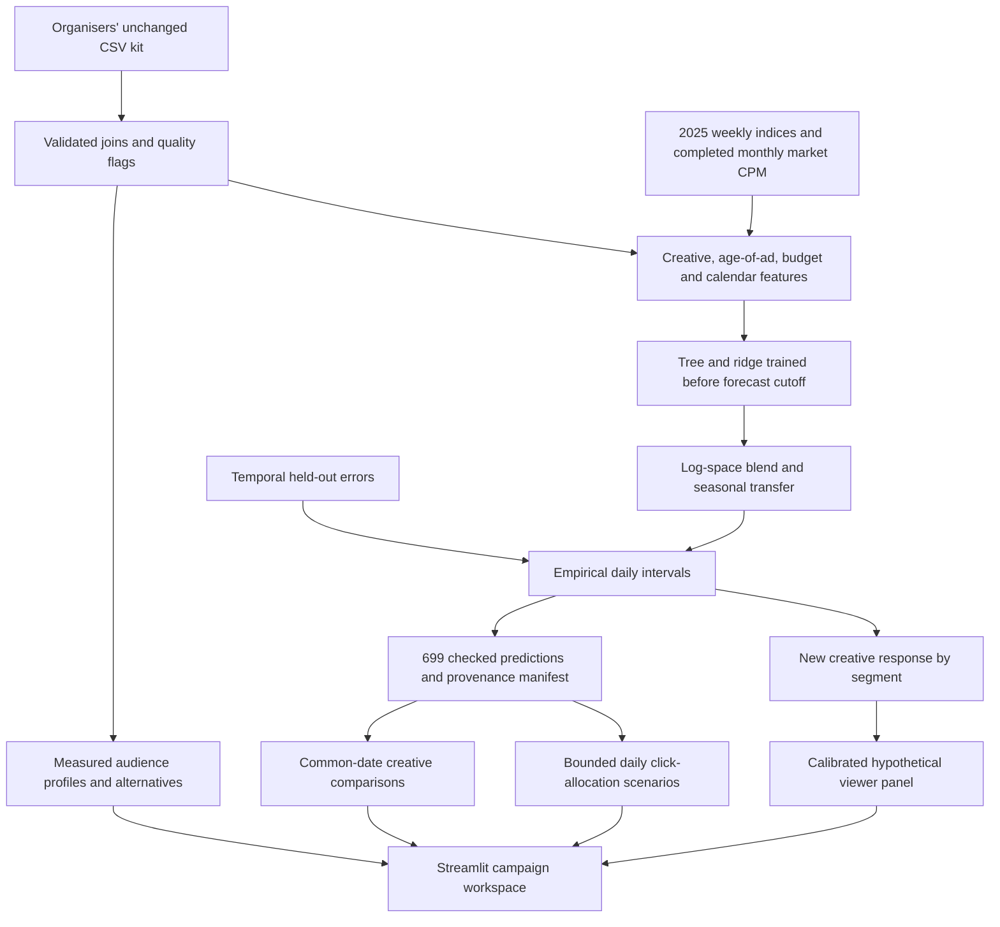

# System design: calibrated campaign rehearsal

## Objective and evidence boundary

Return CTR and CPM for every required ad/date, compare creative responses within each audience segment, and support budget decisions before launch. The supplied kit contains aggregate simulated outcomes, not demographic or person-level observations. A credible system can learn segment response and represent hypothetical viewers; it cannot identify age-specific click rates from these aggregates alone.

The implementation preserves that distinction throughout the UI and exports. Forecast accuracy comes from held-out advertising outcomes. Personas provide a controlled scenario interface. They do not constitute additional training observations.

## Implemented architecture

No remote inference API, API key, external campaign data, or production ad-account access is required. Feature construction and model training are shared by batch prediction and the creative lab. This keeps a new creative on the same forecasting path as the submission.

## Data contracts and time boundaries

The join hierarchy is campaign → ad set → ad → creative. Each required `(data, ad_id, adset_id)` must appear once. Metadata must match `da_prevedere.csv`, and every row needs finite positive CTR/CPM plus ordered daily bounds. CTR is a percentage and cannot exceed 100. `contracts.py` rejects missing, duplicated or mismatched rows before forecast output is written.

Launch dates and planned budgets are known future inputs. Outcomes, spend, impressions, clicks and reported reach are excluded from prediction features. They are used for fitting targets, audience analysis and evaluation only. Training-only encoders/scalers prevent preprocessing from learning validation outcomes.

A monthly market observation is available only after that month ends. For an incomplete or future month, project from the most recent completed 2026 month using the corresponding 2025 monthly ratio. The official November holdout therefore uses October 2026 information. Earlier folds never use realised full-month October CPM while forecasting early October.

The 2025 weekly benchmark is supplied prior-year information. The date minus 364 days is rounded down to Monday. Thus the 2026 Black Friday week maps to 24 November 2025, and Cyber Monday 30 November 2026 maps to 1 December 2025. This is calendar alignment, not evidence that the same lift repeats.

Quality exclusions preserve the original rows and their reasons. Their interpretation as reporting errors remains a hypothesis; raw-validation sensitivity is exported. A zero CTR is incompatible with a log target, but is valid as an evaluation outcome for MAE/WAPE.

## Forecasting model

For metric `m` and row `x`, fit learners to:

`z_m = log(y_m) - log(index_m / 100)`.

The deployed point prediction is:

`y_hat_m = exp(0.5 × tree_m(x) + 0.5 × ridge_m(x)) × index_m / 100`.

The tree uses categorical segment/asset identity and nonlinear creative/context interactions. Ridge provides regularized extrapolation and shared creative coefficients when an asset has no history. Unknown categories are supported. Both ad and asset cold-start flags are exported.

The 50/50 blend is retained because three earlier time windows favour it over the learned alternatives on average log error. A simpler baseline remains competitive. The known November window is reported separately; no claim of a sealed, independently preregistered experiment is made. An experimental ridge with additional audience interactions was rejected after weaker earlier-window performance.

Black Friday event flags are constant in the training history and cannot identify a novel event effect. The prior-year transfer carries that extrapolation. Since the market index also enters the learners, the index offset and fitted effects are not independently identifiable causal terms. No causal creative, demographic or budget coefficients are claimed.

## Uncertainty

For held-out forecast errors, calculate `abs(log(y / y_hat))` separately for known and new ads. Use the `ceil((n + 1) × 0.8)` order statistic, capped at the sample size, for symmetric log bounds:

`[y_hat × exp(-q), y_hat × exp(q)]`.

Calibration must follow model training. To check coverage, calibrate on 2–8 November and test on 9–15 November. The first week contains zero new ads. Its new-ad width therefore comes from an earlier temporal holdout within the training period, whose own predictions exclude those outcomes from fitting. The source and sample counts are exported.

Production is refit through 15 November and transports residual widths from the November holdout. Time dependence, creative correlation, model refitting and seasonal distribution shifts invalidate an automatic exchangeability guarantee. These are empirical intervals. Their coverage is measured and below target, not concealed by the “80%” label. They are neither joint CTR/CPM bounds nor intervals for period averages or winner probabilities.

## Audience hypotheses and synthetic people

Audience analysis uses pooled CTR/CPM, median ad-day frequency, within-ad season-adjusted fatigue, same-asset/day relative CTR and descriptive lever response. Explicit rules generate hypotheses from those metrics. Profiles may repeat or remain ambiguous; ad-set suffixes never determine identity. Frequency is measured per ad/day, with no deduplicated reach across ads.

For an illustrative viewer panel, let group weights `w_g` describe assumed ages and habits. Start with declared habit utilities `u_g`, controlled by a slider that defaults to zero. Solve an intercept `a` by bisection so that:

`sum(w_g × sigmoid(a + u_g)) = predicted_segment_CTR / 100`.

Viewer counts are drawn with a fixed-seed multinomial and clicks with binomial draws. At every setting, weighted expected CTR equals the statistical forecast. Age has no learned effect; different age mixes cannot create an invented age-performance claim. Needs are scenario labels, not inferred customer facts. Habit offsets are explicit user assumptions, not learned preferences.

This panel answers “what would a population consistent with this forecast look like under these assumptions?” It does not prove how real individuals respond or improve the measured forecast. Validated age-specific rates would require age-stratified exposure/click outcomes or an independent experiment unavailable in this kit.

## Creative comparison and explanations

Rank ads on common dates, preventing a fresh launch from being compared against a different seasonal period. Show the actual headline and visual description. Compare daily interval envelopes conservatively; overlapping uncertainty produces a test recommendation. Even separated envelopes are not a calibrated probability that one ad wins.

For new creatives, perturb tags through the same fitted model and report response changes by ad set. Keep obvious dependencies consistent: speaking to camera implies a person; a logo-first introduction removes the early hook. These are predictive sensitivities, with possible off-support combinations. They are not intervention estimates.

## Budget scenarios

For each campaign/day, assume equal ad-level spend within each segment because future delivery shares are unobserved:

`baseline_clicks_i = budget_i × mean_active_ads(10 × CTR% / CPM)`.

Optimize the scenario:

`max sum_i(baseline_clicks_i × (new_budget_i / budget_i)^e)`

subject to a fixed campaign/day total and `0.8 × budget_i ≤ new_budget_i ≤ 1.2 × budget_i`.

Use SLSQP at `e = 0.42`. Round to euro cents while preserving total and bounds. The 0.42 exponent is a sensitivity assumption inspired by one confounded episode, not a fitted treatment effect. Re-evaluate at exponents 0.25, 0.42, 0.7 and 1.0. For adverse KPI sensitivity, charge added spend at low CTR/high CPM and removed spend at high CTR/low CPM. This is a stress scenario, not a probabilistic lower confidence bound.

The product recommends a bounded test. It makes no claim about sales, ROAS or revenue because conversions and revenue were not provided.

## Verification and next evidence to collect

The pipeline exports row-level held-out forecasts, subgroup metrics, raw-row sensitivity, rolling windows, interval provenance and a source/code fingerprint. Integration tests cover forecast completeness, unseen ads, calibration time boundaries, monthly-market availability, ID-independent audience inference, common-date comparisons, daily budget conservation, missing-model recovery and simulation calibration. Streamlit tests exercise all advertisers/segments, metrics, decision windows and creative/viewer controls.

For a production deployment beyond this hackathon, the most valuable additions are a true future holdout, randomised budget/creative tests, demographic outcome breakdowns, actual platform delivery shares, and conversion/revenue outcomes. These are additional data requirements, not features falsely claimed to exist in this implementation.
